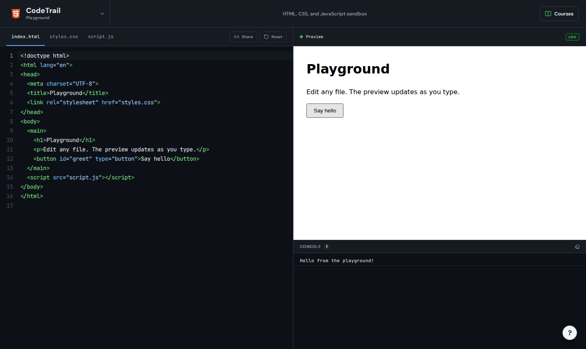

# CodeTrail

Learn HTML and CSS by writing real code. Every lesson checks your work as you type and shows the result in a live preview, so you always know what to fix next.

**[Start learning at guillaumeyves.github.io/codetrail](https://guillaumeyves.github.io/codetrail/)**

No account, no install, no ads. It runs entirely in your browser.


## What's inside

| | |
| --- | --- |
| **HTML course** | 50 lessons, from your first paragraph to an accessible page with landmarks, forms, tables, media, and metadata. |
| **CSS course** | 40 lessons on selectors, typography, the box model, flexbox, grid, states, custom properties, responsive layouts, and motion. |
| **Playground** | A free HTML, CSS, and JavaScript sandbox with a console. Try an idea, then share it with a link. |

Each course goes through four stages: Fundamental, Basic, Intermediate, and Advanced. It ends with a capstone that brings everything together.

## How a lesson works

1. **Read the task.** Each lesson asks for one focused thing and lists exactly what your code must do.
2. **Write the code.** Requirements tick off as you type. HTML checks read the structure of your document. CSS checks confirm your rules really change the page, not just that the text looks right.
3. **Watch the preview.** It updates live as you type. CSS changes apply instantly without reloading the page.
4. **Compare and move on.** Once every requirement passes, complete the challenge. A reference solution then appears so you can compare approaches. Yours can differ and still be right.

Every lesson also points out a common mistake and a good habit to build, so you learn the clean way to write it from the start.

Lessons unlock in order. Finished lessons stay open, so you can revisit them anytime.

## The playground



- Three files: `index.html`, `styles.css`, and `script.js`.
- `console.log` output and errors show up in the built-in console.
- **Share** copies a link that contains your code. Anyone who opens it sees exactly what you wrote.
- Your work is saved automatically.

## Your code stays yours

- Nothing you write is sent to a server. There is no backend.
- Progress and saved code live in your browser's local storage. Clearing site data, or switching to another browser or device, starts fresh.
- The preview runs in a sandboxed frame, cut off from the rest of the page.
- A shared playground link carries the code inside the link itself.

## Keyboard shortcuts

| Shortcut | Action |
| --- | --- |
| `Ctrl` + `Enter` (`Cmd` + `Enter` on Mac) | Complete the challenge, or open the next one |
| `Tab` | Indent in the editor |
| `Esc`, then `Tab` | Leave the editor with the keyboard |
| `Esc` | Close menus and dialogs |

## Run it on your machine

You need [Node.js](https://nodejs.org/) 20.19+ or 22.12+.

```bash
git clone https://github.com/GuillaumeYves/codetrail.git
cd codetrail
npm install
npm run dev
```

`npm run check` runs the linter, the test suite, and a production build.

## Contributing

Ideas, bug reports, and fixes are welcome. Open an issue to discuss a change before starting on anything large.

### Translating CodeTrail

All text lives in JSON files, so you can translate CodeTrail without touching any code.

1. Copy `src/i18n/locales/en.json` to a file named after your language code, such as `fr.json`. This covers the interface.
2. Copy `src/stacks/html/locales/en.json` and `src/stacks/css/locales/en.json` the same way. These cover the lessons.
3. Translate the values only. Keep the keys and any `{placeholders}` as they are.
4. Run `npm test`. It flags unknown keys and placeholders that don't match.

Partial translations are fine. Anything you haven't translated yet falls back to English. Once a second language exists, a language menu appears in the top bar. Visitors whose browser prefers that language get it automatically.

### Writing lessons

Lessons are defined in `src/stacks/<course>/lessons.js`. Each one has a task, its checks, a starter file, and a reference solution. The tests make sure every reference solution passes its own checks. The English text in `locales/en.json` is generated from these files, so edit the lessons rather than the JSON.

## Built with

[React](https://react.dev/), [Vite](https://vite.dev/), and [CodeMirror](https://codemirror.net/).
