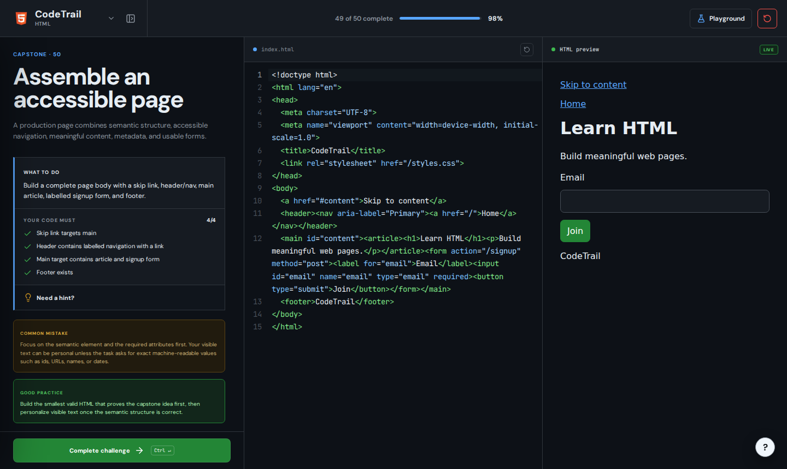
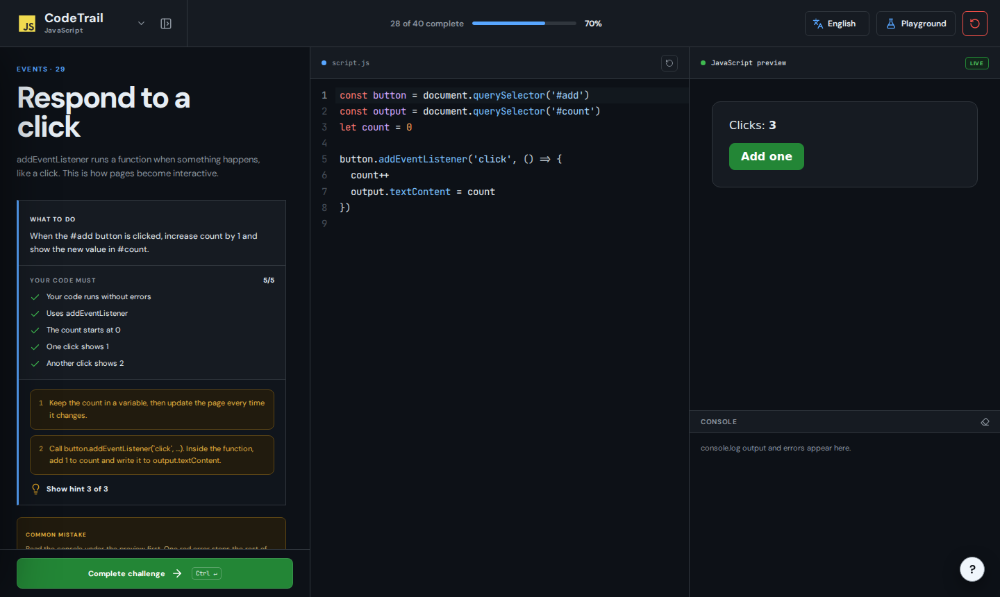

# CodeTrail

Learn HTML, CSS, and JavaScript by writing real code. Every lesson checks your work as you type and shows the result in a live preview, so you always know what to fix next.

**[Start learning at guillaumeyves.github.io/codetrail](https://guillaumeyves.github.io/codetrail/)**

No account, no install, no ads. It runs entirely in your browser, in English or French.



## What's inside

| | |
| --- | --- |
| **HTML course** | 50 lessons, from your first paragraph to an accessible page with landmarks, forms, tables, media, and metadata. |
| **CSS course** | 40 lessons on selectors, typography, the box model, flexbox, grid, states, custom properties, responsive layouts, and motion. |
| **JavaScript course** | 40 lessons, from your first `console.log` to functions, arrays, objects, the DOM, events, classes, promises, and `async`/`await`. It ends with a working to-do app. |
| **Playground** | A free HTML, CSS, and JavaScript sandbox with a console. Try an idea, then share it with a link. |

Each course goes through four stages: Fundamental, Basic, Intermediate, and Advanced. Every lesson only uses what earlier lessons taught, and each course ends with a capstone that brings everything together. New to the web? Take them in order: HTML, then CSS, then JavaScript.

## How a lesson works

1. **Read the task.** Each lesson asks for one focused thing and lists exactly what your code must do.
2. **Write the code.** Requirements tick off as you type. HTML checks read the structure of your document. CSS checks confirm your rules really change the page. JavaScript checks run your code and test what it does: the values it returns, what it prints, and how the page reacts to clicks and typing.
3. **Ask for a hint if you're stuck.** Hints open one at a time: a nudge first, then a direction, then a near answer. Take only the help you need.
4. **Watch the preview.** It updates live as you type. JavaScript lessons add a console that shows `console.log` output and errors.
5. **Compare and move on.** Once every requirement passes, complete the challenge. A reference solution then appears so you can compare approaches. Yours can differ and still be right.

Every lesson also points out a common mistake and a good habit to build, so you learn the clean way to write it from the start.

Lessons unlock in order. Finished lessons stay open, so you can revisit them anytime.



## The playground


- Three files: `index.html`, `styles.css`, and `script.js`.
- `console.log` output and errors show up in the built-in console.
- **Share** copies a link that contains your code. Anyone who opens it sees exactly what you wrote.
- Your work is saved automatically.

## Your code stays yours

- Nothing you write is sent to a server. There is no backend.
- Progress and saved code live in your browser's local storage. Clearing site data, or switching to another browser or device, starts fresh.
- Previews and JavaScript checks run in sandboxed frames, cut off from the rest of the page. A loop that never ends is stopped after one second instead of freezing the tab.
- A shared playground link carries the code inside the link itself.

## Keyboard shortcuts

| Shortcut | Action |
| --- | --- |
| `Ctrl` + `Enter` (`Cmd` + `Enter` on Mac) | Complete the challenge, or open the next one |
| `Tab` | Indent in the editor |
| `Esc`, then `Tab` | Leave the editor with the keyboard |
| `Esc` | Close menus and dialogs |

## Languages

CodeTrail is available in English and French. Your browser language is picked automatically, and the language menu in the top bar switches it anytime. Every lesson, hint, and requirement is translated.

## Run it on your machine

You need [Node.js](https://nodejs.org/) 20.19+ or 22.12+.

```bash
git clone https://github.com/GuillaumeYves/codetrail.git
cd codetrail
npm install
npm run dev
```

`npm run check` runs the linter, the test suite, and a production build.

## Contributing

Bug reports, lesson fixes, translations, and new ideas are all welcome. [CONTRIBUTING.md](CONTRIBUTING.md) explains how to set up the project, write a lesson, and add a language.

## License

[MIT](LICENSE) © 2026 Guillaume YVES

Built with [React](https://react.dev/), [Vite](https://vite.dev/), and [CodeMirror](https://codemirror.net/).
